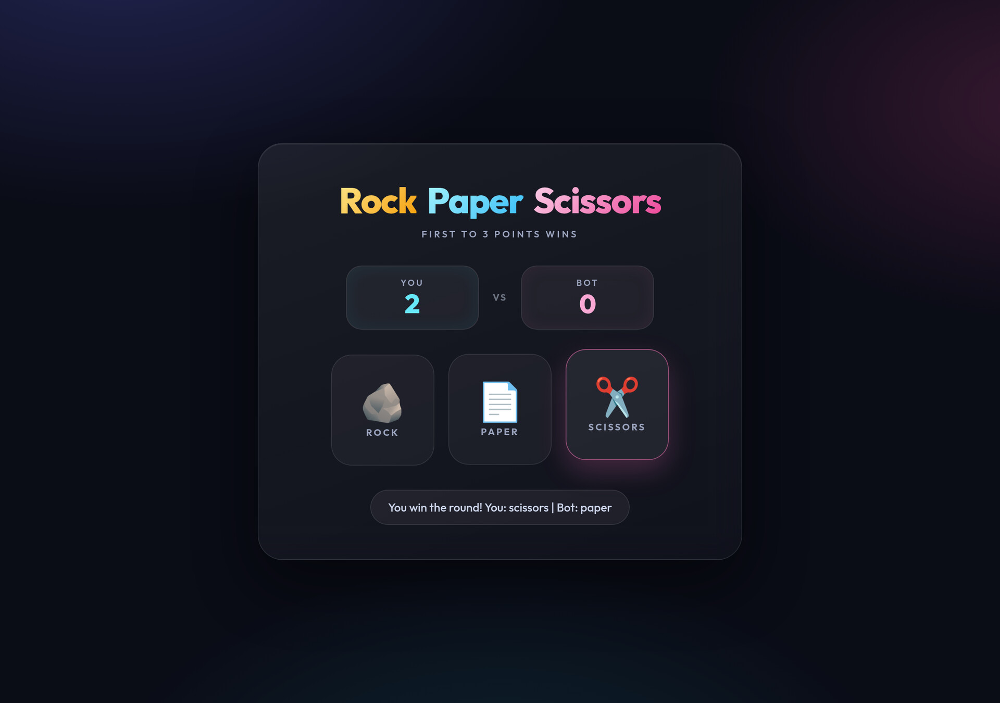

# ✊ Rock Paper Scissors

A small browser game: play rock, paper, scissors against the computer. First to **3 points** wins.



## Features

- Classic player-vs-bot gameplay
- Live scoreboard — first to 3 points wins
- Round result and game-over messages
- Start and Play Again flow
- Responsive dark UI with a mobile layout

## How to play

1. Click **Start Game**
2. Pick 🪨 rock, 📄 paper, or ✂️ scissors
3. Rock beats scissors, scissors beats paper, paper beats rock
4. First to 3 points wins — then hit **Play Again!**

## Run locally

Open `index.html` in your browser, or serve the folder:

```bash
npx serve .
```

## Built with

HTML, CSS, and vanilla JavaScript.
